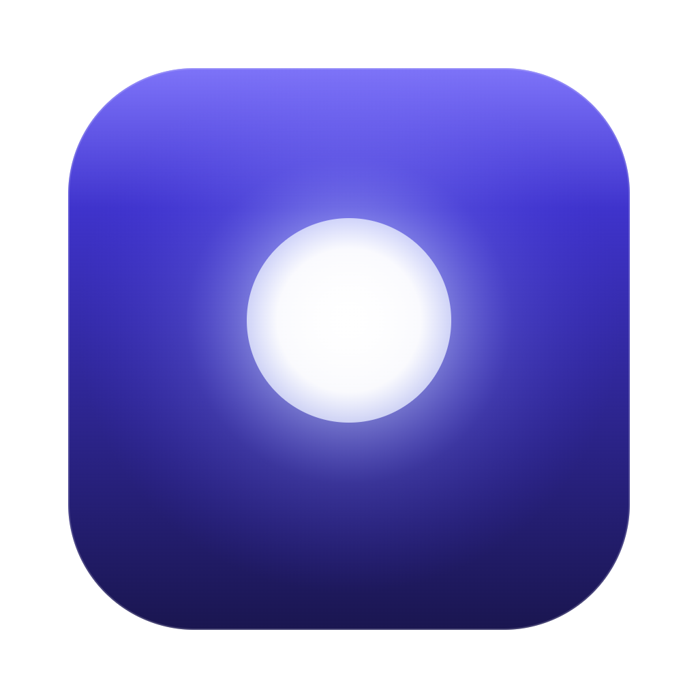

<div align="center">



# Lumen

**A beautiful desktop client for Jellyfin: your movies, shows and music, the Apple way.**

[](https://github.com/Dyskolos-Dev/Lumen/releases/latest)
[](LICENSE)
[](https://github.com/Dyskolos-Dev/Lumen/releases/latest)
[](https://jellyfin.org)

[**Download**](https://github.com/Dyskolos-Dev/Lumen/releases/latest) · [Website](https://lumen.dyskolos.fr) · [Français](README.fr.md)

</div>

---

## ✨ Features

| | |
|---|---|
| 🎬 **Movies & TV shows** | Apple TV-style home with a hero banner, Continue Watching, Next Up and Recently Added; rich detail pages, seasons and episodes. |
| ▶️ **Built-in player** | Direct play or server transcoding (HLS), resume, audio and subtitle tracks, Up Next with auto-play, keyboard shortcuts. |
| 🎵 **Music** | Apple Music-style library, albums, artists, playlists, queue, shuffle and repeat, full-screen Now Playing. |
| 🎤 **Synced lyrics** | Time-synced lyrics that scroll with the song; click a line to jump to it. |
| 📡 **Casting** | Google Cast (music and video), UPnP/DLNA renderers including WiiM, AirPlay on Apple TV (best effort). |
| 🗂️ **Multiple servers** | Add a server with its address, your account and a name; switch in one click. Only an encrypted token is stored, never your password. |
| 🔎 **Global search** | Movies, shows, episodes, artists, albums and songs in one place. |
| 🌗 **Light & dark** | Follows your system, with an accent color of your choice. FR and EN. |
| 🎮 **Discord Rich Presence** | "Listening to" / "Watching" with artwork, toggle in Settings. |
| ⌨️ **Native feel** | Media keys and OS media controls, macOS menu bar, ⌘/Ctrl+R to refresh the library. |
| 🔄 **Automatic updates** | New versions download and install themselves on Windows and Linux (AppImage); on macOS, Lumen tells you and opens the download. |

## 📥 Install

Download the installer for your system from the [latest release](https://github.com/Dyskolos-Dev/Lumen/releases/latest):

| System | File |
|---|---|
| Windows 10/11 | `Lumen-Setup-x.y.z.exe` |
| macOS Apple silicon (M1+) | `Lumen-x.y.z-arm64.dmg` |
| macOS Intel | `Lumen-x.y.z.dmg` |
| Linux | `Lumen-x.y.z.AppImage` or `lumen_x.y.z_amd64.deb` |

> [!NOTE]
> The builds are not code-signed yet. On Windows, click **More info → Run anyway** in SmartScreen. On macOS, right-click the app and choose **Open** the first time.

You need a [Jellyfin](https://jellyfin.org) server, version 10.9 or later.

## 🛠️ Development

Requires Node.js 22+ and npm.

```bash
npm install
npm run dev
```

| Script | What it does |
|---|---|
| `npm run dev` | Starts the app with hot reload |
| `npm run check` | Typecheck, lint, unit tests and build |
| `npm run e2e` | End-to-end tests against a real server (see [docs/QA.md](docs/QA.md)) |
| `npm run dist` | Builds the installer for the current system into `release/` |

Releases are built by GitHub Actions when a `v*` tag is pushed (see [CONTRIBUTING.md](CONTRIBUTING.md)).

Learn more in [docs/ARCHITECTURE.md](docs/ARCHITECTURE.md), [docs/DESIGN.md](docs/DESIGN.md), [docs/JELLYFIN.md](docs/JELLYFIN.md), [docs/CASTING.md](docs/CASTING.md) and [docs/DISCORD.md](docs/DISCORD.md).

## 📄 License

Lumen is released under the [MIT License](LICENSE).

Lumen is an independent project. It is not affiliated with or endorsed by Jellyfin or Apple.

<div align="center">

Made with ❤️ by [Dyskolos_](https://dyskolos.fr)

</div>
